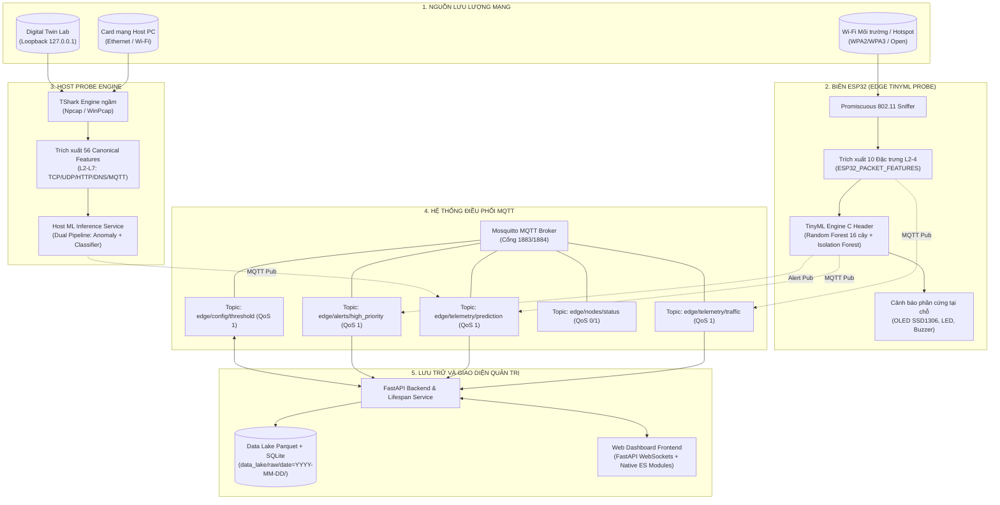

# AERO — Giám sát lưu lượng mạng và thí nghiệm Edge AI

AERO gồm host TShark capture, telemetry ESP32, MQTT, Python FastAPI/dashboard,
training ML offline, Parquet/SQLite data lake và Digital Twin/RL/GAN thử nghiệm.
Tài liệu cập nhật theo implementation ngày **12/10/2026**.

**--twin-lab dùng loopback, không dùng Wi-Fi**, target cố định **127.0.0.1**.
Đã có pipeline workload/capture/import và attribution theo flow; **chưa bảo đảm
Normal/attack trong Twin đại diện cho loopback tổng quát, Wi-Fi thực hoặc tái hiện
attack của paper Edge-IIoTset**.

## Tính năng hiện có

- Host tự chạy TShark ngầm, không cần mở GUI Wireshark. Đọc TCP/UDP/ICMP/HTTP/TLS/QUIC…
  tùy traffic; lọc MQTT/dashboard của hệ thống để giảm vòng phản hồi telemetry.
- Input model là **56 canonical features**, theo ml_engine/config/schema.py.
  Có **15 nhãn tổng cộng: Normal và 14 attack**; số cột CSV gốc khác số input model.
- Runtime nạp artifacts đã train, không tự train. Có dual pipeline anomaly detector
  và classifier; không bảo đảm độ chính xác, latency hoặc zero false positive trên mạng mới.
- MQTT realtime tách packet, cửa sổ tốc độ và prediction. Packet QoS 1 vẫn bị drop
  trước publish khi queue đầy; PUBACK không xác nhận collector đã ghi Parquet.
- Data lake lưu packet nhận được vào Parquet theo ngày, metadata trong SQLite.
  Summary chỉ tính batch còn file; không cam kết lưu đủ mọi live packet.
- Dashboard có packet inspector, rate/protocol chart, prediction, workload status
  và lake summary. Chart bổ sung polling API mỗi 2 giây; workload status mỗi 5 giây.
  Các module JS có fingerprint chung để tránh dùng lẫn component cũ/mới.
- Nút Normal/attack UI chạy **workload Twin + PCAP capture + Parquet import**.
  Accepted không đồng nghĩa COMPLETED hay attack được xác minh.
- ESP32 có radio sniffer, window telemetry, local alert và inference/export modules.
  Window ESP32 không tương đương 56 host packet features; không coi Wi-Fi mã hóa
  là TCP/HTTP plaintext đo được. Cần artifact phù hợp khả năng probe.
- Twin vật lý/RL và GAN là thành phần thử nghiệm. Vector simulation không phải
  packet đo thật; thử policy chưa chứng minh phòng thủ mạng thực.

## Chuẩn bị

Python 3.10+, dependencies requirements.txt, Wireshark/TShark và dumpcap.
Windows cần Npcap để capture. Có Mosquitto native hoặc broker đang chạy, và
artifacts tương thích với classifier/anomaly được chọn.

~~~powershell
python -m pip install -r requirements.txt
~~~

Tạo .env từ .env.example **chỉ nếu chưa có .env**; giữ secrets/cấu hình hiện có.
Launcher nạp .env ở repository; biến môi trường có sẵn ưu tiên hơn .env, CLI broker
flags ưu tiên hơn cấu hình broker. Host dùng mạng hệ điều hành đã kết nối, không
cần SSID/password để capture.

## Kiến trúc & Sơ đồ Pipeline tổng thể

Hệ thống hoạt động theo mô hình phân tán đa tầng (Hybrid Multi-Tier): Giám sát biên thời gian thực (ESP32 Edge Probe) kết hợp Host Monitoring, điều phối qua Broker MQTT tập trung, lưu trữ Data Lake chuẩn Parquet/SQLite và hiển thị Web Dashboard trực quan.



---

## 1. Thu thập & Xử lý dữ liệu (Data Ingestion & Preprocessing)

Hệ thống hỗ trợ 2 chế độ trích xuất đặc trưng tùy thuộc vào probe thu thập và môi trường mạng:

### A. Chế độ Biên ESP32 (10 Đặc trưng Layer 2–4 — `ESP32_PACKET_FEATURES`)
Được thiết kế chuyên biệt để chạy trong môi trường **Wi-Fi mã hóa (WPA2/WPA3)** và tài nguyên siêu giới hạn của vi điều khiển:
- Không giải mã dữ liệu người dùng (giữ tính riêng tư và bảo mật), chỉ đọc header 802.11 bóc tách MAC, IP, TCP/UDP/ICMP/ARP:
  1. `arp.opcode`: Mã thao tác ARP (Request/Reply - phát hiện ARP Spoofing).
  2. `arp.hw.size`: Kích thước địa chỉ phần cứng ARP.
  3. `icmp.checksum`: Checksum gói ICMP (phát hiện ICMP Flood).
  4. `tcp.srcport`: Cổng nguồn TCP.
  5. `tcp.dstport`: Cổng đích TCP (phát hiện Port Scanning/Brute-force).
  6. `tcp.flags`: Cờ TCP (SYN, ACK, FIN, RST, PSH, URG - phát hiện SYN Flood/XMAS Scan).
  7. `tcp.flags.ack`: Trạng thái cờ ACK.
  8. `tcp.len`: Chiều dài payload TCP.
  9. `tcp.ack_raw`: Số Sequence/Acknowledgment thô.
  10. `tcp.checksum`: Checksum tầng giao vận TCP.
- **Tiền xử lý & Scaling trên ESP32:** Vector 10 số thực được chuẩn hóa MinMax/Standard scaler trực tiếp bằng thuật toán C tối ưu hóa dấu phẩy động trong `esp32_packet_model.h`.

### B. Chế độ Toàn phần Host (56 Đặc trưng Canonical)
Sử dụng TShark ngầm trên máy tính để bóc tách sâu các trường từ L2 đến L7:
- Toàn bộ các trường L2-L4 cơ bản cộng với thông tin ứng dụng HTTP, DNS, MQTT, ICMP rates, cửa sổ thời gian trượt (IAT, Byte rate, Packet rate).
- Chi tiết quy định tại [ml_engine/config/schema.py](ml_engine/config/schema.py).

### C. Data Lake tự động (Parquet + SQLite)
- **Định dạng Parquet:** Gói tin thu thập được lưu trữ theo cột và nén Snappy/GZIP theo ngày (`data_lake/raw/date=YYYY-MM-DD/sess_<id>.parquet`), giúp tốc độ đọc phân tích nhanh gấp 100 lần so với CSV truyền thống.
- **SQLite Catalog:** Lưu metadata từng session, số lượng packet, nhãn ghi nhận, tính toàn vẹn của batch và hỗ trợ truy vấn tức thì từ API `/api/data-lake/summary`.

---

## 2. Giao thức & Hệ thống MQTT (MQTT API Specifications)

AERO sử dụng kiến trúc Pub/Sub tách biệt hoàn toàn giữa luồng dữ liệu (Data Plane) và luồng điều khiển (Control Plane):

| Topic | Hướng | QoS | Payload JSON chính | Ý nghĩa |
| :--- | :---: | :---: | :--- | :--- |
| `edge/telemetry/traffic` | Probe $\rightarrow$ Broker | 1 | `timestamp`, `probe_id`, `features` (10 hoặc 56 trường), `raw_metadata` | Dữ liệu đặc trưng gói tin thu thập theo thời gian thực. |
| `edge/telemetry/prediction` | Probe $\rightarrow$ Broker | 1 | `timestamp`, `probe_id`, `threat_level`, `attack_type`, `confidence`, `probabilities`, `anomaly_score` | Kết quả phân loại đa lớp và điểm số bất thường từ mô hình ML/TinyML. |
| `edge/alerts/high_priority` | Probe $\rightarrow$ Broker | 1 | `timestamp`, `probe_id`, `severity`, `rule_triggered`, `source_ip`, `target_ip` | Cảnh báo khẩn cấp khi điểm bất thường vượt ngưỡng `edge_threshold`. |
| `edge/nodes/status` | Probe $\rightarrow$ Broker | 0/1 | `node_id`, `hardware`, `ip`, `rssi`, `uptime_ms`, `free_heap_bytes`, `state` | Nhịp tim định kỳ và báo cáo sức khỏe tài nguyên phần cứng. |
| `edge/config/threshold` | Dashboard $\leftrightarrow$ Probe | 1 | `threshold` (0.0 – 1.0), `applied_at` | Điều chỉnh động ngưỡng cảnh báo anomaly mà không cần nạp lại firmware. |
| `edge/experiments/status` | Backend $\rightarrow$ UI | 1 | `status` (PREPARING, RUNNING, IMPORTING, COMPLETED), `scenario`, `experiment_id` | Đồng bộ trạng thái thực nghiệm Digital Twin Lab. |

---

## 3. Module ESP32 Probe (Edge AI TinyML)

ESP32 Probe là điểm đột phá cho phép **giám sát biên không xâm nhập (Non-intrusive Over-The-Air Sniffing)**:

1. **Thu thập không dây (Promiscuous 802.11 Mode):**
   - ESP32 đặt card Wi-Fi ở chế độ Promiscuous, lắng nghe toàn bộ khung truyền sóng trong không gian ở kênh (channel) chỉ định.
   - Bộ lọc phần cứng FreeRTOS lọc nhanh các khung Management/Beacon, chỉ chuyển khung Data hợp lệ qua ring buffer có giới hạn dung lượng để chống tràn bộ nhớ.
2. **TinyML Inference Engine:**
   - Mô hình Random Forest (16 Decision Trees) + Isolation Forest được biên dịch trực tiếp sang mã nguồn C thuần (`esp32_packet_model.h`).
   - Cây quyết định được biểu diễn dưới dạng cây if/else nhị phân phẳng, không cấp phát bộ nhớ động (Zero dynamic heap allocation), thời gian suy luận **dưới 5 ms/gói tin**.
   - Cấu hình phân vùng bộ nhớ Flash: Sử dụng bảng phân vùng `PartitionScheme=huge_app` (3MB cho App), chiếm ~38–47% dung lượng Flash của ESP32.
3. **Cảnh báo và tự trị (Edge Autonomy):**
   - Khi mất kết nối MQTT về máy chủ, ESP32 vẫn tiếp tục suy luận độc lập và kích hoạt còi/LED/OLED tại chỗ khi phát hiện tấn công.

---

## 4. Hướng dẫn vận hành & Các chế độ chạy

### Bước 1: Chuẩn bị môi trường
- Cài đặt Python 3.10+, Wireshark (Npcap trên Windows), Mosquitto native.
- Cài đặt Arduino-CLI và ESP32 board core (`esp32:esp32`) nếu muốn tự động nạp firmware cho ESP32.
- Cài đặt các thư viện Python:
  ```powershell
  python -m pip install -r requirements.txt
  ```

---

### Bước 2: Huấn luyện mô hình TinyML cho ESP32 (Offline Training)
Nếu muốn huấn luyện mô hình Random Forest 16 cây + Isolation Forest từ tập dữ liệu Edge-IIoTset (lọc 10 đặc trưng L2-4):

```powershell
python -m ml_engine.edge.train --classifier random_forest --trees 16 --output ml_engine/models/esp32_edgeiiot_rf16
```
*(Lệnh sẽ xuất toàn bộ trọng số, scaler và file C header `esp32_packet_model.h` vào thư mục chỉ định).*

---

### Bước 3: Khởi chạy hệ thống

#### Chế độ A: Giám sát biên qua ESP32 (Tự động biên dịch, nạp firmware & kết nối Hotspot)
Kết nối ESP32 qua cáp micro-USB vào máy tính (ví dụ cổng COM4), bật Hotspot trên điện thoại hoặc máy tính:

```powershell
python run_system.py --probe esp32 --classifier random_forest --anomaly-model isolation_forest --models-dir ml_engine/models/esp32_edgeiiot_rf16 --arduino-cli --wifi-ssid "Tên_Hotspot" --wifi-pass
```
- Launcher sẽ tự động:
  1. Đồng bộ file `esp32_packet_model.h` mới nhất vào thư mục firmware.
  2. Tạo cấu hình `credentials.h` tạm chứa SSID/Password.
  3. Dùng `arduino-cli` biên dịch và nạp xuống ESP32.
  4. Khởi chạy Mosquitto Broker, Data Lake Collector và FastAPI Dashboard tại `http://localhost:8000`.

#### Chế độ B: Giám sát lưu lượng Host (Card mạng máy tính thực tế)
Quan sát lưu lượng Ethernet hoặc Wi-Fi đi qua máy tính cá nhân bằng TShark ngầm:

```powershell
python run_system.py --probe host --classifier random_forest --anomaly-model isolation_forest
```

#### Chế độ C: Thử nghiệm Digital Twin Lab (Loopback & Sinh kịch bản tấn công)
Dành cho kiểm thử an toàn các kịch bản DoS, Scan, Injection trên loopback `127.0.0.1`:

```powershell
python run_system.py --probe host --twin-lab
```
*(Truy cập giao diện Web `http://localhost:8000`, bấm các nút kịch bản để bắt đầu bắn workload và thu PCAP).*

## Cấu hình .env

Cấu hình host + lab tại nhà:

~~~dotenv
MQTT_BROKER_HOST=127.0.0.1
MQTT_BROKER_PORT=1883
HOST_CAPTURE_INTERFACES=""
HOST_PCAP_FILE=""
HOST_PROBE_ID=Host-PC-Live-Probe
LAB_TARGET_IP=127.0.0.1
LAB_ALLOWED_TARGETS=127.0.0.1/32
LAB_HTTP_PORT=8088
LAB_CAPTURE_INTERFACES=auto-loopback
TWIN_LAB_BACKEND=native
TWIN_CAPTURE_INTERFACE=auto-loopback
AUTO_DETECT_WIFI=false
MQTT_AUTO_DISCOVERY=false
~~~

| Khóa | Hành vi |
| --- | --- |
| HOST_CAPTURE_INTERFACES | run_system tự cập nhật device ID card vật lý đang up ở startup host thường; lab chỉ override trong bộ nhớ. |
| LAB_CAPTURE_INTERFACES | --lab-capture: auto-loopback hoặc một tên/index loopback hợp lệ; không dùng index 8 cố định. |
| TWIN_CAPTURE_INTERFACE | --twin-lab và worker experiment: auto-loopback hoặc loopback hợp lệ; không chuyển sang Wi-Fi. |
| HOST_PCAP_FILE | Host replay PCAP/PCAPNG thay vì live. Để rỗng khi khảo sát thực; hai flag lab xóa override cho lần chạy. |
| TWIN_LAB_BACKEND | native sở hữu HTTP target; docker yêu cầu target container đã chạy. |
| LAB_HTTP_PORT | HTTP lab 8088, phải khác broker/dashboard. |
| LAB_TARGET_IP, LAB_ALLOWED_TARGETS | Ràng buộc generator legacy; không thay target Twin hiện cố định localhost. |
| WIFI_SSID, WIFI_PASSWORD | Cấu hình firmware ESP32; không tự kết nối Wi-Fi của hệ điều hành host. |
| AUTO_DETECT_WIFI, MQTT_AUTO_DISCOVERY | Discovery opt-in, mặc định false; không cần cho host lab. |

Liệt kê adapter trong PowerShell:

~~~powershell
& 'C:\Program Files\Wireshark\tshark.exe' -D
~~~

Số NIC có thể đổi sau cài WSL/Hyper-V/VirtualBox. Dùng auto-loopback cho lab,
tên thiết bị cho Wi-Fi chỉ định. TSHARK_PATH có thể chỉ executable nếu không ở
đường dẫn mặc định; discovery chờ 15 giây và báo lỗi cụ thể.

Không commit .env/credentials. ESP32 dùng credentials.h ignored từ
credentials.h.example; thay SSID/password cần build/flash.
**Dừng launcher bằng Ctrl+C rồi chạy lại sau đổi .env/backend**; reload trang
không nạp cấu hình process. --dashboard-port và --threshold có defaults CLI
8000 và 0.55: muốn đổi hãy dùng flags, không chỉ sửa PORT/ANOMALY_THRESHOLD.

## Runtime flags

Danh sách chính xác: **python run_system.py --help**.

| Flag | Hành vi / lưu ý |
| --- | --- |
| --probe host/esp32/sim | Nguồn telemetry; mặc định host. |
| --broker-host, --broker-port | Chọn MQTT; broker remote phải chạy sẵn. Launcher dùng broker local sẵn có hoặc khởi động local. |
| --dashboard-port 8000 | Cổng dashboard. |
| --classifier random_forest, --anomaly-model isolation_forest | Chọn artifacts; không tự train. |
| --models-dir PATH | Chỉ định bundle artifacts. |
| --threshold 0.55 | Ngưỡng runtime, không phải xác minh ground truth. |
| --window 1.0 | Chu kỳ cửa sổ đo host, đơn vị giây. |
| --twin-lab | Host loopback + UI workload/capture/import; không có workload thì capture=0 có thể bình thường. |
| --lab-capture | Đổi host capture sang loopback, không sinh traffic. |
| --no-tshark | Host fallback, không bảo đảm 56 packet features; không dùng với hai flag lab. |
| --no-browser | Không tự mở browser. |
| --record-lake, --no-record-lake, --no-record | Bật/tắt MQTT live collector, mặc định bật. Không tắt persistence của worker Twin. |
| --attack-sim, --attack-target | Generator legacy riêng; target phải thuộc lab allowlist. Không cần để chạy nút Twin, không kết hợp --twin-lab. |
| --no-sim | Alias chế độ hardware ESP32; không đồng nghĩa tắt workload Twin. |
| --arduino-cli, --flash, --port COM4 | Build/upload board; không dùng khi chỉ khảo sát host. |
| --rl-defense | Twin/RL service thử nghiệm; khác --twin-lab. |
| --enforce-real-network | Opt-in enforcement OS; không cần để collect, chưa là policy thực đã được kiểm chứng. |
| --push-remote | Cloud sync; chỉ bật khi chủ động cấu hình upload dữ liệu. |

Một số flags dùng SmartBooleanAction, như --attack-sim false.
Hai flag lab là store_true. Cách chọn model khác:
python run_system.py --help; danh sách training: python train.py --list-models.

## Workload Twin đã hợp lý với thực tế chưa?

**Chưa xác minh tương đương.** Loopback dùng socket thật nhưng không có radio,
airtime contention, RF loss hay RTT/link-layer như mạng vật lý. Pkt/s cao không
chứng minh workload đúng.

| Lớp UI | Hành vi hiện có | Bằng chứng / giới hạn |
| --- | --- | --- |
| Normal | HTTP GET/POST, 64/512/4096/16384 byte, nghỉ 50–200 ms, seed theo experiment. | HTTP 200/header/nội dung được kiểm tra. Chỉ baseline HTTP; chưa đa dạng MQTT/DNS/TLS/QUIC/thiết bị. |
| Port_Scanning | TCP connect scan nhiều cổng lab sở hữu, hai open và các cổng closed. | Mặc định 8088–8099; không scan ứng dụng khác của Windows. |
| Vulnerability_scanner | HTTP probe robots/admin/config/backup endpoints. | Request scan, không chứng minh exploit; không phải Nikto toàn bộ. |
| DDoS_TCP | Crafted SYN-only giới hạn trên Linux; Windows dùng container Linux. | Không dùng TCP connect fallback; chưa đo distributed DoS impact. |
| DDoS_HTTP | HTTP workload giới hạn. | Chưa đo tác động từ chối dịch vụ. |
| DDoS_UDP | UDP burst tới receiver lab thực, payload đa kích thước. | Có counter receive; một nguồn loopback, không phải botnet phân tán. |
| Uploading | Multipart HTTP upload file fixture. | Không thực thi PHP/webshell hoặc lưu file người dùng. |
| SQL_injection / XSS | Grammar query/form/JSON vào SQLite tạm và endpoint phản chiếu. | SQL SELECT injection được test trên fixture; browser XSS chưa test execution. |
| DDoS_ICMP | ICMP echo ID/timestamp attribution, raw Linux/container. | Không gán nhãn ICMP lỗi của traffic UDP là ICMP flood. |
| Password | Nhiều login attempts vào tài khoản lab. | Có phản hồi success/failure; không dùng tài khoản thật. |
| Fingerprinting | SYN/ACK/SYN-ACK tới cổng open/closed, ICMP echo và banner HTTP. | Kiểm tra đáp ứng TCP/ICMP; surrogate probe, không kết luận OS bằng xprobe2. |
| MITM | Relay DNS đổi địa chỉ sensor.test sang dịch vụ lab khác; client truy cập theo đáp án và nhận nội dung bị thay đổi. | DNS diversion surrogate; không tái hiện ARP poisoning. |
| Backdoor | Agent fixture kết nối ngược; controller đọc inventory và bytes fixture qua TCP. | Không shell/persistence; chỉ fixture tự tạo. |
| Ransomware | Kênh ngược điều khiển AES-256-GCM trên ba file fixture, truyền ciphertext, khôi phục và kiểm tra bytes. | Chỉ file tạm trong container; không dùng file người dùng. |

SQLi/XSS hiện dùng grammar v1, mỗi lớp 8 family và query GET/form POST/JSON POST,
thay cho danh sách cố định 6/4 request. Đã kiểm tra offline 10.000 unique requests
mỗi lớp. Cùng pool endpoint/parameter/User-Agent; Normal cũng dùng chung pool
User-Agent. Manifest ghi actual generator seed, version và số request theo family/
placement; Parquet ghi request_variant_id/template_family/placement/method theo
flow. Đây là metadata để group split, không phải input model. Không lấy số unique
chuỗi làm chứng minh tính thực tế. Xem [SQLi/XSS variants](docs/SQLI_XSS_VARIANTS.md).

Đã có dispatch/UI cho Normal + 14 lớp. Bốn surrogate v4 được nhận vào supervised
training sau kiểm chứng effect trên flow, vẫn không phải tái hiện benchmark.
Khi chạy `--twin-lab` trên Windows, launcher tự mở Docker Desktop ngầm nếu engine
chưa sẵn sàng, chờ Linux engine tối đa 120 giây rồi mới chọn interface capture.
Worker kiểm tra lại nếu Docker bị đóng giữa phiên. Docker phải được cài và hoàn tất
setup WSL2/virtualization; lỗi hoặc timeout được báo rõ, không tự chuyển từ Windows
containers sang Linux containers. Không cần thêm flag hoặc sửa `.env` cho auto-start.
Launcher không tắt Docker Desktop khi thoát vì đây là dịch vụ dùng chung.
Image aero-twin-raw:v4 được dựng
khi chạy lần đầu nếu thiếu. Container không có network ngoài, chỉ mount thư mục
experiment; PCAP trong container được import về lake host. Host realtime loopback
không nhìn thấy loopback bên trong container. Không tự retrain model.
Xem [audit phiên mới và fidelity](docs/TWIN_ATTACK_AUDIT_20261012.md).
Normal và attack tự gán nhãn cho packet khớp flow hai chiều và thời gian.
Policy hiện tại **không yêu cầu label_verified**; nhãn có nguồn controlled_flow.
Đây là attribution workload, không chứng minh attack thành công. Packet nền/không attributable và ICMP
chưa có attribution tuple gốc giữ Unknown. Không bấm attack không tự gán Normal
cho mọi packet; prediction của model không phải ground truth.

Muốn đánh giá: thu Normal Wi-Fi riêng, Normal lab riêng, so cùng dịch vụ/workload
theo protocol, frame/payload size, request rate, IAT, RTT và tỷ lệ error. Cần thêm
UDP/MQTT receiver hoạt động, dịch vụ test phù hợp từng attack và bằng chứng tác
động để đánh giá độ đúng kịch bản. Chia train/test theo phiên/môi trường; chưa concat chỉ vì
đủ feature hoặc chọn đúng nút.

Snapshot đến batch 204: 84.566 live rows Unknown; bốn Twin capture nhập đủ 11.150
PCAP packets; kết quả 0 eligible trong audit cũ dùng verified gate trước thay đổi policy.
Hiện nhãn controlled_flow hợp lệ được nhận dù cờ cũ false. Đã sửa manifest nguồn wildcard TCP/UDP cho phiên mới;
không tự đổi dữ liệu cũ. Xem [audit session 204](docs/A%20Linh/PARQUET_SESSION_204_AUDIT_12_10_2026.md).

## Training offline và data lake

### Nội dung thô dành cho NLP sau này

Host live và Twin importer lưu thêm metadata riêng, không đổi 56 model features:
raw_tcp_payload_hex (bytes dưới dạng hex), raw_tcp_payload_text (UTF-8 hợp lệ,
không tạo plaintext cho TLS/QUIC), raw_http_query, raw_http_uri, raw_http_body,
raw_mqtt_message/topic và raw_packet_info. Chuỗi được giữ nguyên trước categorical
normalization, kể cả khoảng trắng và literal 0. Không tự tokenize/fit NLP encoder.
Xem [raw application content](docs/RAW_APPLICATION_CONTENT.md) cho encoding,
missing/truncation và giới hạn packet-level. Cần restart host/backend để áp dụng;
Parquet cũ không tự được bổ sung nội dung.

~~~powershell
python train.py --help
python train.py --classifier random_forest --anomaly-model isolation_forest --data-source edge-iiotset --invalid-rows drop
~~~

Lệnh thứ hai **train và ghi artifacts**, chỉ chạy khi chủ động huấn luyện;
dùng --output-dir nếu muốn giữ bundle cũ. --invalid-rows drop loại record benchmark
malformed có báo cáo; không sửa nhãn hoặc phục hồi packet mất của live capture.
CSV ML snapshot đã quan sát 396 malformed records và 5.411 exact feature/label
duplicates loại trước sampling/split; số liệu phụ thuộc dataset.

Training có holdout test; preprocessing fit train, HPO fit trong fold.
--refit-full là deployment refit sau đánh giá, không phải artifact được kiểm thử
độc lập trên dữ liệu chưa nhìn thấy. --timeseries hiện bị chặn chờ session splits
và runtime/export parity. CLI dùng --sample-ratio, không dùng --samples cũ.
--data-source hybrid tồn tại và là default training; cần audit nhãn/provenance/domain
trước khi dùng, không tự concatenate mọi Parquet.

Hybrid đọc lake một lần và chỉ các cột training, không nạp raw body/Info cho model 56
features. Log báo path, eligibility và counts theo lớp. Nếu thiếu Normal lake trong
30 ngày, Isolation Forest dùng Normal TRAIN benchmark; attack lake hợp lệ vẫn vào
classifier. Thông báo này không có nghĩa lake rỗng. Thu Normal Twin nếu muốn baseline
lab, không đổi tất cả Unknown thành Normal. oneDNN startup messages không phải lỗi
concat; các log đó có thể xuất hiện do dependencies ML được import.

Tối ưu retraining: packet đã qua quality gate được project cả bảng theo đúng thứ tự
56 features, thay vì tạo DataFrame cho từng packet; encoding/scaling vẫn ở preprocessor.
Bỏ lượt transform classifier lake trước khi refit TRAIN vì kết quả đó bị ghi đè.
Parquet footer và projected columns được đọc qua cùng handle. Không cần flag mới;
log `Read + quality gate` tách thời gian đọc/kiểm tra khỏi phần sau. Đo trên 5.000
packet lake: extraction cũ 17,72s, projection mới 0,015s, đọc 0,26s. Đây là tốc độ
của bước extraction, không phải mức tăng tốc toàn training. Ba regression xác nhận
vector/encoding parity, mixed schema và hybrid training. Không cache scaler/encoder
giữa các lần fit; không bỏ quality gate hay thay đổi split để tăng tốc.

Wi-Fi và loopback nên giữ dataset/evaluation và profile triển khai riêng, nhất là
Normal baseline/threshold của anomaly detector. Classifier chung/hybrid chỉ nên chọn
sau so benchmark-only, domain-specific và mixed model trên test theo session ở từng
domain. Pipeline hiện chưa có CLI tự lọc domain/routing model; --data-source hybrid
đọc mọi dòng lake đủ điều kiện, holdout chính là benchmark. --output-dir (training)
và --models-dir (runtime) có thể quản lý bundle riêng, nhưng không tự lọc dữ liệu
Wi-Fi/loopback. Không random-split packet cùng flow để chứng minh generalization.

data_lake/quality.py yêu cầu packet schema hợp lệ, identity và nhãn canonical từ
controlled_flow/manual_review; không kiểm tra label_verified (cột cũ nếu có bị bỏ qua).
Protocol không có field dùng zero theo contract; field không đo được phải ghi missing.
Unknown hoặc context UI không attributable vẫn không đủ điều kiện training.

Capture Twin giới hạn loopback và endpoint sở hữu: scan dùng dải TCP từ LAB_HTTP_PORT
theo TWIN_SCAN_PORT_COUNT (mặc định 12), các HTTP/UDP workload dùng cổng chính.
MITM DNS fixture thêm UDP cổng chính+2; ICMP chỉ echo identifier của experiment.
Host realtime dùng hợp các scope lab, không phải mọi socket loopback.

Khi bật --twin-lab, host probe realtime cũng lọc đúng cổng lab này. Đường inference
là host TShark → MQTT → model đã nạp → dashboard; importer PCAP Twin chỉ ghi Parquet,
không suy luận lại mọi dòng nhập vào lake. Vì thế counts PCAP/lake không phải số lượt
inference. UI hiển thị top 5 xác suất và thêm xác suất lớp đang chọn trong Twin nếu
model có lớp đó, kể cả khi xác suất thấp hoặc bằng 0. Nhãn collect không ép model
đoán đúng lớp; anomaly gate quyết định cảnh báo cuối, độc lập với thanh xác suất.

Ngày 12/10/2026, theo xác nhận của người vận hành rằng các phiên thực địa không có
attack, đã review 304.685 packet Unknown ngoài dấu hiệu lab thành Normal. Nhãn ghi
manual_review/operator_assertion, giữ nhãn/source trước đó và ID annotation. 4.475
Unknown có dấu hiệu lab được giữ lại; các nhãn attack đã có không đổi. Bản sao gốc
và review.json ở data_lake/label_backups/de40eb6fb3d6419b8b4d5150c6057935/.
Đây là review snapshot đã có, không tự đổi Unknown của các phiên tương lai. Công cụ
`python scratch/apply_operator_normal.py` xem trước; `--apply` áp dụng với backup.
Gán nhãn không tự cập nhật model đang chạy: train lại bundle chủ động, rồi restart
run_system với đúng --classifier/--anomaly-model hoặc --models-dir đã train.

## Docker, MQTT và vận hành

Native Twin không cần Docker. HTTP target container:

~~~powershell
docker compose --env-file .env -f digital_twin/lab/compose.yaml up -d
~~~

Đặt TWIN_LAB_BACKEND=docker, restart launcher. Service chỉ publish localhost,
network container nội bộ; Windows capture trên loopback cổng publish, không phải
toàn bộ container bridge. Compose config đã kiểm tra, runtime container chưa được
kiểm chứng trong các audit trên; worker không tự chạy Compose.

Packet edge/telemetry/traffic QoS 1; window edge/telemetry/window QoS 0;
edge/experiments/status QoS 1 retained, chỉ thông tin. Commands legacy QoS 1 không
retained. Xem [MQTT API](docs/MQTT_API_SPEC.md).

Log Host captured/published/dropped/failed thuộc đường realtime: failed=0 không
phủ nhận queue drop. Manifest Twin có bộ đếm PCAP/parse/save riêng; COMPLETED xác
nhận import thành công, không xác nhận driver zero loss.

## Cấu trúc và tài liệu

| Đường dẫn | Trách nhiệm |
| --- | --- |
| run_system.py, wrappers .bat/.sh | Runtime orchestration. |
| firmware/host_probe/, launcher/ | Host capture, workers, discovery, serial/flash helpers. |
| firmware/esp32_probe/ | C++ radio, inference, MQTT/alerts. |
| firmware/simulator/ | Legacy generator và telemetry simulation. |
| broker/ | Mosquitto config/manager và development fallback. |
| dashboard/backend/, dashboard/frontend/ | FastAPI, MQTT/WebSocket, native JS modules. |
| data_lake/ | Collector, Parquet/SQLite, quality gate và optional cloud sync. |
| digital_twin/experiment_service.py, digital_twin/lab/ | Workload/capture/attribution, HTTP target. |
| digital_twin/ | Physics/RL/safety/enforcement thử nghiệm. |
| ml_engine/, train.py | Schema, preprocessing, training/inference/export. |
| docs/, Literature/, tests/, scratch/ | Tài liệu, nghiên cứu, regression/audit. |

- [Chạy Twin và schema nhãn](docs/TWIN_EXPERIMENT_COLLECTION.md)
- [Host packet collection](docs/HOST_PACKET_COLLECTION.md)
- [Data health review](docs/DATA_HEALTH_AND_COLLECTION_REVIEW.md)
- [Digital Twin/GAN](docs/DIGITAL_TWIN_AND_GAN_GUIDE.md) — đối chiếu implementation.
- Đề án: docs/Sáng tạo trẻ.docx; hướng dẫn agent: AGENTS.md.

## Kiểm tra và phạm vi xác minh

~~~powershell
node tests/dashboard_controls.mjs
node tests/dashboard_windows.mjs
python -m unittest discover -s tests -p test_twin_experiments.py -v
python -m unittest discover -s tests -p test_dashboard_assets.py -v
~~~

Các tests không tái hiện benchmark hoặc xác minh attack thực. Native capture
integration trong test Twin là opt-in; tests thường có HTTP/socket localhost benign.
Không chạy test_traffic_generator.py như unit test: có thể gửi traffic thật.
test_pipeline.py là smoke test hạn chế, cần model/broker, không chứng minh toàn bộ
subscriber path. Pilot Normal/PCAP nhỏ không bảo đảm throughput dài hạn, độ đa dạng,
latency ESP32 hay model quality trên mạng triển khai.

## Giấy phép

MIT — xem [LICENSE](LICENSE).
