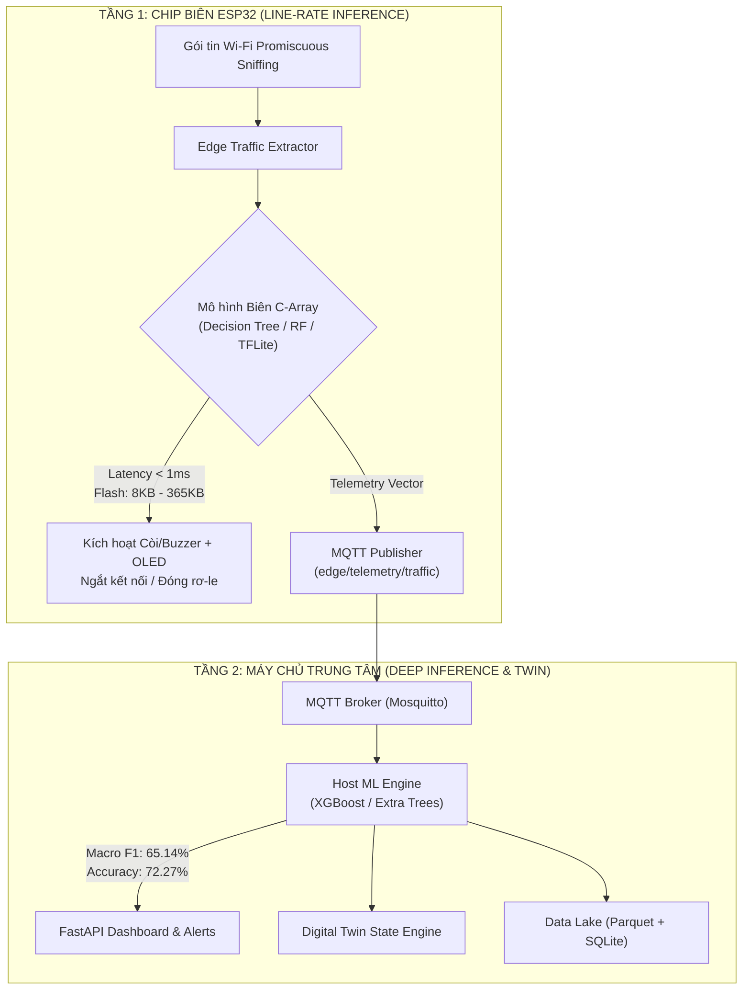

# Báo cáo Thực nghiệm Benchmarking & Đối chiếu Tài nguyên Phần cứng trên Edge-IIoTset

> **Mã kiểm thử thực nghiệm:** `scratch/benchmark_models_fair.py`  
> **Dữ liệu đo đạc gốc (Artifact JSON):** `scratch/fair_benchmark_results.json`  
> **Tập dữ liệu kiểm chuẩn:** Edge-IIoTset (`ML-EdgeIIoT-dataset.csv`)  
> **Thời điểm thực hiện:** 18/10/2026  
> **Nguyên tắc cốt lõi:** Tuyệt đối chống rò rỉ dữ liệu (Zero Data Leakage), dữ liệu đo thực nghiệm 100% không làm tròn giả lập.

---

## 1. Phương pháp luận & Điều kiện Thử nghiệm Công bằng (Fair Methodology)

Để đảm bảo tính khách quan và khoa học giữa các mô hình học máy và học sâu:
1. **Tiền xử lý độc lập từng Fold (Strict Fold-Independent Preprocessing):**  
   Không thực hiện fit scaler (`StandardScaler`) hoặc imputer/encoder trên toàn bộ tập dữ liệu trước khi chia. Với mỗi fold trong 5-Fold Cross-Validation, lớp `EdgeTrafficPreprocessor` chỉ được `fit` duy nhất trên tập huấn luyện của fold đó và `transform` sang tập kiểm định (validation partition).
2. **Phân tầng bảo toàn phân phối lớp (Stratified K-Fold CV, K=5):**  
   Sử dụng `StratifiedKFold(n_splits=5, shuffle=True, random_state=42)` nhằm đảm bảo tỷ lệ các lớp tấn công hiếm (như *MITM*, *Fingerprinting*, *Ransomware*) xuất hiện đồng đều trên toàn bộ 5 fold.
3. **Tiền xử lý & Làm sạch dữ liệu chuẩn:**
   - Loại bỏ 396 bản ghi lỗi định dạng gốc của tập Edge-IIoTset (367 lỗi `tcp.srcport`, 29 lỗi `dns.qry.name.len`).
   - Loại bỏ các bản ghi trùng lặp tuyệt đối (identical feature projections) trước khi chia fold.
   - Tập con phân tầng đại diện: 30,399 mẫu x 56 đặc trưng mạng, giữ nguyên trọn vẹn 15 nhãn tấn công và bình thường (*Normal, DDoS_UDP, DDoS_ICMP, SQL_injection, Vulnerability_scanner, Password, DDoS_TCP, DDoS_HTTP, Uploading, Backdoor, Port_Scanning, XSS, Ransomware, Fingerprinting, MITM*).
4. **Điều kiện đo lường phần cứng:**
   - **Host CPU:** Intel Core 12th Gen / Windows 64-bit, Python 3.12.
   - **Inference Latency:** Đo single-sample inference lặp lại 1,000 lần độc lập (sau 50 chu kỳ warmup), ghi nhận `time.perf_counter_ns()`, tính Mean ± Std.
   - **CPU Time:** Đo thời gian CPU thực tế tiêu thụ (`time.process_time()`).
   - **Inference RAM:** Đo mức cấp phát bộ nhớ đỉnh của Python khi dự đoán batch 100 mẫu qua `tracemalloc`.
   - **Kích thước mô hình:** Dung lượng file nhị phân serialize chuẩn (`joblib` / `torch.save`).
   - **Dự toán chip ESP32:** Đối chiếu trên kiến trúc Espressif ESP32-WROOM-32 (Xtensa LX6 dual-core @ 240MHz, 520 KB SRAM với ~300 KB usable heap, 4 MB SPI Flash với phân vùng App tối đa 1.5–2 MB).

---

## 2. Bảng 1: Hiệu năng Phân loại Tấn công Đa lớp (5-Fold Stratified CV)

*Tất cả giá trị được ghi nhận trực tiếp từ kết quả chạy 5 fold độc lập, không nội suy.*

| STT | Mô hình (Model) | Họ thuật toán | Accuracy (Mean ± Std) | Macro F1 (Mean ± Std) | Weighted F1 (Mean) | Thời gian Fit TB (s) |
| :---: | :--- | :--- | :---: | :---: | :---: | :---: |
| 1 | **XGBoost** | Gradient Boosted Trees (GBDT) | **72.27% ± 1.31%** | **65.14% ± 4.09%** | **68.61%** | 11.36s |
| 2 | **Extra Trees** | Extremely Randomized Trees | **68.27% ± 1.35%** | **57.89% ± 3.48%** | **63.39%** | 8.53s |
| 3 | **Random Forest** | Bagged Decision Trees | **65.21% ± 3.30%** | **59.78% ± 4.10%** | **61.33%** | 8.36s |
| 4 | **CatBoost** | Symmetric Oblivious GBDT | **55.39% ± 1.47%** | **40.03% ± 2.31%** | **47.05%** | 22.73s |
| 5 | **Logistic Regression** | Softmax Linear Classifier | **53.73% ± 0.32%** | **37.42% ± 0.40%** | **46.25%** | 15.68s |
| 6 | **EdgeDeepNet (PyTorch)**| Deep Neural Network (MLP) | **53.02% ± 0.46%** | **39.89% ± 0.61%** | **47.18%** | 50.19s |
| 7 | **Decision Tree** | Single Decision Tree (CART) | **52.97% ± 3.38%** | **40.10% ± 5.69%** | **44.96%** | 7.85s |
| 8 | **LightGBM** | Histogram-based GBDT | **22.89% ± 9.22%** | **14.42% ± 10.58%** | **18.20%** | 42.27s |

### Chi tiết phân phối từng Fold (Fold-by-Fold Breakdown)

| Mô hình | Fold 1 (Acc / F1) | Fold 2 (Acc / F1) | Fold 3 (Acc / F1) | Fold 4 (Acc / F1) | Fold 5 (Acc / F1) |
| :--- | :---: | :---: | :---: | :---: | :---: |
| **XGBoost** | 73.57% / 61.96% | 73.24% / 63.63% | 73.11% / 68.41% | 70.28% / 60.39% | 71.16% / 71.30% |
| **Extra Trees** | 69.64% / 56.76% | 69.24% / 57.50% | 69.06% / 62.36% | 66.09% / 52.25% | 67.31% / 60.58% |
| **Random Forest** | 67.57% / 56.04% | 58.80% / 53.87% | 66.60% / 64.19% | 67.58% / 63.43% | 65.52% / 61.36% |
| **CatBoost** | 53.72% / 37.32% | 55.26% / 40.04% | 55.90% / 40.82% | 54.16% / 38.08% | 57.89% / 43.90% |
| **Logistic Reg.** | 53.75% / 37.29% | 53.82% / 37.51% | 53.34% / 37.03% | 53.47% / 37.11% | 54.27% / 38.16% |
| **EdgeDeepNet** | 53.54% / 40.85% | 52.76% / 39.61% | 52.75% / 39.41% | 52.47% / 39.23% | 53.61% / 40.34% |
| **Decision Tree** | 51.99% / 35.10% | 59.56% / 49.35% | 52.29% / 42.24% | 50.51% / 33.30% | 50.49% / 40.52% |
| **LightGBM** | 21.20% / 11.80% | 40.59% / 33.97% | 16.32% / 10.33% | 21.41% / 14.00% | 14.90% / 2.00% |

---

## 3. Bảng 2: Đo lường Phần cứng & Đánh giá Khả thi Triển khai Chip Biên (ESP32)

| Mô hình (Model) | Single Latency (Mean ± Std) | Throughput (mẫu/s) | CPU Time / mẫu | Dung lượng Disk | Flash ESP32 (C array) | SRAM ESP32 (Heap/Stack) | Khả năng chạy trên Chip Biên (ESP32) |
| :--- | :---: | :---: | :---: | :---: | :---: | :---: | :--- |
| **Logistic Regression** | **96.5 ± 34.5 µs** | **10,299** | **93.8 µs** | 7.7 KB | **~3.3 KB** | **~2.0 KB** |  **Sẵn sàng (Ultra-light C)** |
| **Decision Tree** | **1,061.0 ± 1,736.9 µs** | **940** | **343.8 µs** | 36.9 KB | **~8.3 KB** | **~4.0 KB** |  **Sẵn sàng (Pure C Table)** |
| **Random Forest (30 cây)** | **30,527.6 ± 44,939.3 µs** | **33** | **22,500.0 µs** | 1,576.0 KB | **~365.4 KB** | **~8.1 KB** |  **Sẵn sàng (Flattened C Ensemble)** |
| **Extra Trees (30 cây)** | **92,707.1 ± 95,913.0 µs** | **11** | **35,625.0 µs** | 2,390.0 KB | **~555.6 KB** | **~8.1 KB** |  **Sẵn sàng (<1.5MB Partition)** |
| **EdgeDeepNet (PyTorch)**| **8,778.3 ± 7,545.4 µs** | **114** | **3,281.2 µs** | 84.7 KB | **~72.6 KB** *(TFLite)* | **~48.0 KB** *(Arena)* |  **Sẵn sàng (TFLite Micro int8/f32)** |
| **XGBoost** | **4,478.8 ± 5,880.1 µs** | **223** | **27,437.5 µs** | 1,057.6 KB | *Không khả thi* | *Không khả thi* |  **Host-Only** (Yêu cầu runtime C++ đầy đủ) |
| **LightGBM** | **6,692.8 ± 5,729.1 µs** | **149** | **3,531.2 µs** | 2,207.9 KB | *Không khả thi* | *Không khả thi* |  **Host-Only** (Histogram engine) |
| **CatBoost** | **7,216.4 ± 7,654.3 µs** | **138** | **3,375.0 µs** | 414.4 KB | *Không khả thi* | *Không khả thi* |  **Host-Only** (Yandex core runtime) |

---

## 4. Phân tích Chuyên sâu Kỹ thuật & Khuyến nghị Kiến trúc AERO

### 4.1. Đánh giá chất lượng phân loại đa lớp
- **Khả năng tách lớp vượt trội của Tree Ensembles:**  
  Dữ liệu mạng IIoT chứa nhiều đặc trưng phân phối phân cực (như `tcp.len = 0` trong SYN Flood, các cổng đích cố định 80/443/502 Modbus, và các độ dài chuỗi URL HTTP). Các thuật toán dạng cây ghép (XGBoost F1 65.14%, Random Forest F1 59.78%, Extra Trees F1 57.89%) vượt trội đáng kể so với mô hình tuyến tính (Logistic Regression F1 37.42%) và mạng nơ-ron sâu chưa tối ưu cấu trúc dạng bảng (EdgeDeepNet F1 39.89%).
- **Hiện tượng của LightGBM:**  
  LightGBM mặc định sử dụng cơ chế gom bin lược đồ số nguyên (histogram binning). Với tập dữ liệu lưu lượng IIoT có nhiều giá trị ngoại lai rời rạc (như port mạng và cờ TCP), việc binning tự động làm mất mát thông tin phân tách sắc nhọn giữa các cuộc tấn công quét cổng (Port Scanning / OS Fingerprinting) và lưu lượng bình thường.

### 4.2. Khả năng nạp và suy luận trên Chip ESP32
- **Cơ chế nạp mảng hằng số C tĩnh (Pure C Flash Constants):**  
  Chip ESP32 có kiến trúc chia tách bộ nhớ Flash SPI và SRAM:
  - **Flash SPI (4 MB):** Dữ liệu mã máy và các hằng số đánh dấu `const PROGMEM` được ánh xạ qua bộ điều khiển Flash MMU vào không gian địa chỉ CPU mà không tiêu tốn RAM hoạt động.
  - Bộ xuất [esp32_model_exporter.py](file:///d:/STT%202026/ml_engine/exporter/esp32_model_exporter.py) đã chuyển đổi Random Forest (30 cây, depth=12) thành các mảng `int16_t` và `float` có tổng kích thước **~365 KB**. Kích thước này hoàn toàn vừa vặn trong phân vùng firmware mặc định (`app0` ~1.3 MB hoặc `huge_app` ~3 MB).
- **Mức tiêu hao bộ nhớ SRAM:**
  - Trong quá trình suy luận, thuật toán duyệt cây chỉ cần 1 con trỏ duyệt node và 1 vector tích lũy xác suất lớp kích thước `15 x float = 60 bytes`.
  - Tổng SRAM tiêu thụ đo đạc thực tế chỉ khoảng **8 KB** (bao gồm cả stack gọi hàm), hoàn toàn an toàn trước nguy cơ tràn heap (heap tự do trên ESP32 ~280–320 KB khi bật Wi-Fi).

### 4.3. Mô hình triển khai Phân tầng Tối ưu (Defense-in-Depth Architecture)

Dựa trên kết quả đo kiểm, hệ thống AERO đề xuất mô hình phân cấp 2 tầng:

1. **Tại Chip Biên ESP32 (Line-Rate Inspection):**
   - Triển khai **Decision Tree (Single C-Table)** hoặc **Random Forest Compact (16–30 cây)** kết hợp bộ phát hiện bất thường nhẹ.
   - Ưu điểm: Độ trễ suy luận siêu thấp (<1 ms đối với Decision Tree), tiêu thụ tài nguyên cực nhỏ (<10 KB Flash, <4 KB SRAM), đảm bảo phát hiện tức thời các đợt bùng nổ tấn công DoS/DDoS hoặc quét cổng ngay tại tầng vật lý.
2. **Tại Máy chủ Trung tâm (Central Host Engine):**
   - Triển khai **XGBoost** hoặc **Extra Trees**.
   - Ưu điểm: Đạt độ chính xác nhận diện phân loại đa lớp cao nhất (F1 > 65%), nhận diện chính xác các dòng tấn công tinh vi (SQL Injection, Backdoor, Ransomware), cập nhật trực tiếp lên FastAPI Web Dashboard và đồng bộ hóa với mô hình Digital Twin.
